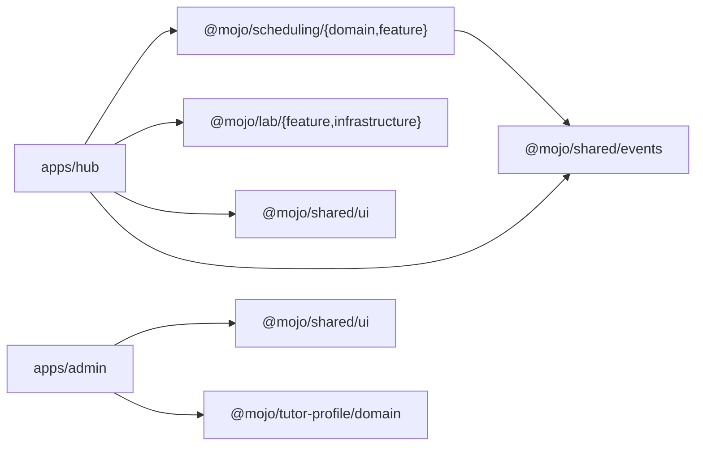
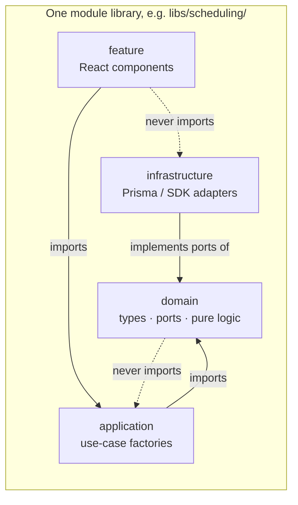

# Mojo — 01. Structural Diagrams

System structure of the Mojo Nx monorepo as built. Two Next.js applications compose
~19 domain modules plus four shared libraries, all behind one database and one
in-process event bus.

Reference: `assets/mojo-monorepo-structure.md` and `assets/mojo-modules.md` describe
the *intent*; this document reflects what actually exists in the tree.

---

## 1. Container diagram — applications, modules, and external systems

```mermaid
flowchart TB
    subgraph EXTERNAL["External systems"]
        DB[(Postgres / Supabase)]
        LK[LiveKit cloud]
        PS[Paystack API]
        RS[Resend email API]
        WA[WhatsApp Cloud API]
    end

    subgraph APPS["apps/ — Next.js applications"]
        HUB[hub<br/>marketplace · student + tutor]
        ADM[admin<br/>admin panel · separate deploy]
    end

    subgraph SHARED["libs/shared/"]
        UI[shared/ui · design system]
        UTIL[shared/util · cn, dates]
        DOMSG[shared/domain · Money, TimeRange]
        EVT[shared/events · EventBus + catalog]
    end

    subgraph PLATFORM["Platform modules"]
        NOTIF["notifications · scaffold"]
        ADMC["admin-config · scaffold"]
        ANALY["analytics · scaffold"]
    end

    subgraph ENGAGE["Trust / Engage / Learning"]
        TRUST["trust-safety · scaffold"]
        MESS["messaging · scaffold"]
        REV["reviews · scaffold"]
        REF["referrals · scaffold"]
        AI["ai-learning · scaffold"]
    end

    subgraph COMMERCE["Commerce"]
        PRIC["pricing · full-depth"]
        PLUS["mojo-plus · full-depth"]
        PAY["payments · full-depth"]
        BILL["billing · scaffold"]
    end

    subgraph MKT["Marketplace"]
        DISC["discovery · scaffold"]
        SCHED["scheduling · full-depth"]
        BOOK["booking · full-depth"]
        LAB["lab · full-depth"]
    end

    subgraph TUTOR["Tutor"]
        TPROF["tutor-profile · scaffold"]
        TPERF["tutor-performance · scaffold"]
    end

    subgraph IDENT["Foundation"]
        IDENTITY["identity · full-depth"]
    end

    HUB --> UI
    HUB --> EVT
    HUB --> SCHED
    HUB --> LAB
    ADM --> UI
    ADM --> TPROF

    UI --> UTIL
    PRIC --> DOMSG
    PAY --> DOMSG
    EVT --> DOMSG
    SCHED --> DOMSG

    BOOK --> SCHED
    BOOK --> EVT
    REV --> EVT
    TRUST --> EVT
    PAY --> EVT
    PLUS --> EVT
    TPERF --> EVT
    PRIC --> EVT

    LAB --> LK
    PAY --> PS
    NOTIF --> RS
    NOTIF --> WA

    IDENTITY --> DB
    SCHED --> DB
    BOOK --> DB
    PRIC --> DB
    PAY --> DB
    PLUS --> DB
    ADMC --> DB
    REV --> DB
    REF --> DB
    TRUST --> DB
    BILL --> DB
    MESS --> DB
    AI --> DB
    TPROF --> DB
    TPERF --> DB
    TPERF --> PRIC
    DISC --> PRIC
```



> **[divergence]** The planning docs list `pricing` and `discovery`, etc., with the
> same layering. Only the modules tagged `full-depth` above have repositories that
> touch Postgres today; the rest are domain-type depth only even though the schema
> already contains their tables.

Note the external systems actually referenced **in code**:
- `libs/lab/src/infrastructure/livekit-lab.adapter.ts` → LiveKit (`AccessToken`, JWT)
- `libs/payments/src/infrastructure/paystack.adapter.ts` → Paystack Transfers (`fetch`)
- `libs/notifications/src/infrastructure/email.adapter.ts` → Resend (`fetch`)
- `libs/notifications/src/infrastructure/whatsapp.adapter.ts` → WhatsApp Cloud API (`fetch`)
- `prisma/schema.prisma` → Postgres via `@prisma/client`

---

## 2. Module ↔ application mapping

Which application wires which module libraries (as `@mojo/*/…` path aliases from
`tsconfig.base.json`):



`apps/hub`'s `proxy.ts` (`middleware.ts`-style route gate) enforces the
`/tutor/:path*` and `/student/:path*` prefixes by reading a `mojo_role` cookie —
it does **not** parse sessions itself; that belongs to `@mojo/identity`'s
application layer (per its own comment, `apps/hub/proxy.ts:15`).

---

## 3. Clean-architecture layering inside a module

Every module in `libs/` is split into the same four layers. Dependencies point
**inward**: `domain` imports nothing from the module's other layers;
`application` imports only `domain`; `infrastructure` implements `domain`'s ports;
`feature` imports `application` and `shared/ui` — and never `infrastructure`.



Nx tags declare each library's scope; the `shared/*` libraries additionally carry
layer tags (`type:domain`, `type:ui`, `type:util`) so module boundaries can be
enforced by the build (the `@nx/enforce-module-boundaries` convention described in
the monorepo doc — note the actual `project.json` files only tag `scope:*` today;
layer enforcement is planned, not yet wired, see `[divergence]` below).

> **[divergence]** `assets/mojo-monorepo-structure.md:99-101` says boundaries are
> enforced with `type:*` tags + `depConstraints` in `biome.json`. Inspecting the
> tree: every **module** library carries only `["scope:<module>"]`; only the four
> `shared/*` libraries carry `type:*` tags, and `biome.json` has **no** `useImport`
> / `overrides` for dependency rules. Enforcement is therefore aspirational.

---

## 4. Full source tree (implementation-relevant)

The directories that actually contain implementation code (`.ts`/`.tsx`/`.prisma`):

```
apps/
  hub/     app/  (tutor)/home · (tutor)/lab/[sessionId] · (student)/home · layout
           proxy.ts · next.config.js · tailwind.config.ts
  admin/   app/  nexus · tutors/applications · layout
libs/
  shared/
    domain/      money.ts · time-range.ts
    events/      event-bus.ts · events.types.ts
    ui/          button.tsx · badge.tsx · card.tsx · input.tsx · alert.tsx · styles/globals.css
    util/        cn.ts · date.ts
  identity/      domain(ports, user.types, password-policy) · application(register, authenticate)
                 infrastructure(prisma-user, bcrypt) · feature(login-form)
  scheduling/    domain(availability, session, ports, conflict-detection)
                 application(book, cancel, set-availability) · infrastructure(prisma) · feature(calendar, editor)
  booking/       domain(ports, session-lifecycle) · application(confirm-delivery) · infrastructure(prisma)
  lab/           domain(lab.types) · infrastructure(livekit.adapter) · feature(lab-room)
  pricing/       domain(types, ports, calculate-lesson-charge) · application(record-session-completion)
                 infrastructure(prisma-tutor-level)
  payments/      domain(wallet, ports) · application(release-payout) · infrastructure(prisma-wallet, paystack)
  mojo-plus/     domain(mojo-plus.types) · application(subscribe) · [no infrastructure, no feature]
  # scaffold-depth modules — domain type + one thin use-case each:
  tutor-profile  domain · application(submit-application)
  tutor-performance domain · application(recompute-level)
  discovery      domain · application(search-tutors)
  billing        domain · application(manage-subscription)
  messaging      domain · application(send-message)
  reviews        domain · application(submit-review)
  referrals      domain · application(track-referral)
  trust-safety   domain · application(file-dispute)
  ai-learning    domain · application(generate-recap)
  notifications  domain · infrastructure(email, whatsapp)   [domain + infra only]
  admin-config   domain                                  [domain only]
  analytics      domain                                  [domain only]
prisma/          schema.prisma (23 models, 6 enums)
```

Notes on asymmetry (honest reflection, not an error):
- `mojo-plus` is **full-depth by tests/specs** (its use-cases are unit-tested) but has
  **no infrastructure layer** and no `feature` — it is implemented only as far as its
  repository port + use-cases.
- `notifications` has domain + infrastructure (email/whatsapp adapters) but **no
  application use-case** — the dispatchers exist but nothing orchestrates them.
- `admin-config` and `analytics` are **domain-only** (types, no logic, no port-I/O).
