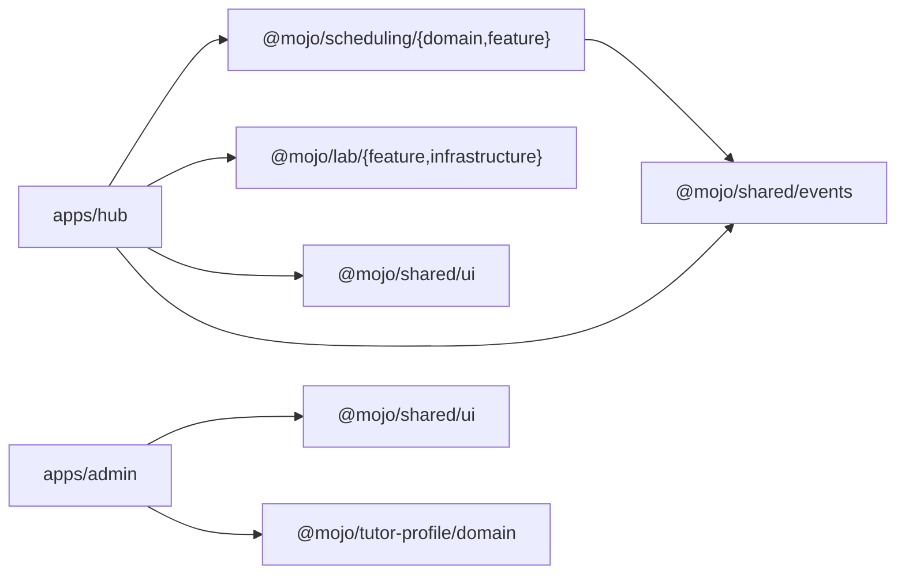
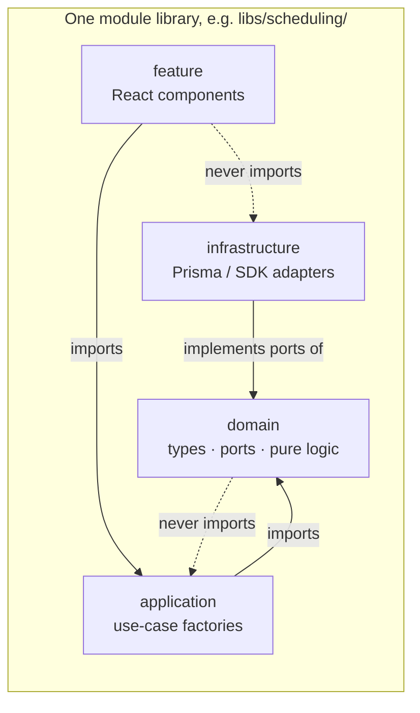

# Mojo — 01. Structural Diagrams

System structure of the Mojo Nx monorepo as built. Two Next.js applications compose
~19 domain modules plus four shared libraries, all behind one database and one
in-process event bus.

Reference: [`docs/mojo-monorepo-structure.md`](../mojo-monorepo-structure.md) and
[`docs/mojo-modules.md`](../mojo-modules.md) describe the *intent*; this document
reflects what actually exists in the tree.

---

## 1. Container diagram — applications, modules, and external systems

```mermaid
flowchart TB
    subgraph EXTERNAL["External systems"]
        DB[(Postgres / Supabase)]
        LK[LiveKit cloud]
        PS[Paystack API]
        RS[Resend email API]
        WA[WhatsApp Cloud API]
    end

    subgraph APPS["apps/ — Next.js applications"]
        HUB[hub<br/>marketplace · student + tutor]
        ADM[admin<br/>admin panel · separate deploy]
    end

    subgraph SHARED["libs/shared/"]
        UI[shared/ui · design system]
        UTIL[shared/util · cn, dates]
        DOMSG[shared/domain · Money, TimeRange, TutorLevel]
        EVT[shared/events · EventBus + catalog]
    end

    subgraph PLATFORM["Platform modules"]
        NOTIF["notifications · full-depth"]
        ADMC["admin-config · full-depth"]
        ANALY["analytics · full-depth"]
    end

    subgraph ENGAGE["Trust / Engage / Learning"]
        TRUST["trust-safety · full-depth"]
        MESS["messaging · full-depth"]
        REV["reviews · full-depth"]
        REF["referrals · full-depth"]
        AI["ai-learning · full-depth"]
    end

    subgraph COMMERCE["Commerce"]
        PRIC["pricing · full-depth"]
        PLUS["mojo-plus · full-depth"]
        PAY["payments · full-depth"]
        BILL["billing · full-depth"]
    end

    subgraph MKT["Marketplace"]
        DISC["discovery · full-depth"]
        SCHED["scheduling · full-depth"]
        BOOK["booking · full-depth"]
        LAB["lab · full-depth"]
    end

    subgraph TUTOR["Tutor"]
        TPROF["tutor-profile · full-depth"]
        TPERF["tutor-performance · full-depth"]
    end

    subgraph IDENT["Foundation"]
        IDENTITY["identity · full-depth"]
    end

    HUB --> UI
    HUB --> EVT
    HUB --> SCHED
    HUB --> LAB
    ADM --> UI
    ADM --> TPROF

    UI --> UTIL
    PRIC --> DOMSG
    PAY --> DOMSG
    EVT --> DOMSG
    SCHED --> DOMSG
    DISC --> DOMSG

    BOOK --> EVT
    REV --> EVT
    TRUST --> EVT
    PAY --> EVT
    PLUS --> EVT
    TPERF --> EVT
    PRIC --> EVT
    TPROF --> EVT
    REF --> EVT

    LAB --> LK
    PAY --> PS
    NOTIF --> RS
    NOTIF --> WA

    IDENTITY --> DB
    SCHED --> DB
    BOOK --> DB
    PRIC --> DB
    PAY --> DB
    PLUS --> DB
    ADMC --> DB
    REV --> DB
    REF --> DB
    TRUST --> DB
    BILL --> DB
    MESS --> DB
    AI --> DB
    TPROF --> DB
    TPERF --> DB
    DISC --> PRIC
    DISC --> DOMSG
```



> Every module above is **full-depth**: each has `domain` ports/types, an
> `application/` use-case layer, `infrastructure/` Prisma/SDK adapters implementing
> its ports (all wired to Postgres), and Vitest specs. The `[divergence]` notes that
> previously flagged scaffold-depth modules no longer apply.

Module-to-module dependency is deliberately minimal (dependency inversion): the only
module that imports another module is `discovery` → `@mojo/pricing/domain` (its search
index reads pricing's published rate contract `DEFAULT_SEGMENT_RATE_NGN`).
`booking` used to reach into `@mojo/scheduling/domain` and `tutor-performance` into
`@mojo/pricing/domain`; both now depend only on `@mojo/shared/*` — booking declares
its own `BookingSession` contract, and `TutorLevel` lives in `shared/domain`. All
other inter-module behaviour flows through `@mojo/shared/events`.

Note the external systems actually referenced **in code**:
- `libs/lab/src/infrastructure/livekit-lab.adapter.ts` → LiveKit (`AccessToken`, JWT)
- `libs/payments/src/infrastructure/paystack.adapter.ts` → Paystack Transfers (`fetch`)
- `libs/notifications/src/infrastructure/email.adapter.ts` → Resend (`fetch`)
- `libs/notifications/src/infrastructure/whatsapp.adapter.ts` → WhatsApp Cloud API (`fetch`)
- `prisma/schema.prisma` → Postgres via `@prisma/client`

---

## 2. Module ↔ application mapping

Which application wires which module libraries (as `@mojo/*/…` path aliases from
`tsconfig.base.json`):



`apps/hub`'s `proxy.ts` (`middleware.ts`-style route gate) enforces the first
path segments `tutor`, `tutors`, `lab` (role → `/tutor/:path*` for tutors,
`/tutors/:path*` + `/lab/:path*` for students) by reading a `mojo_role` cookie —
it does **not** parse sessions itself; that belongs to `@mojo/identity`'s
application layer (per its own comment, `apps/hub/proxy.ts:15`).

---

## 3. Clean-architecture layering inside a module

Every module in `libs/` is split into the same four layers. Dependencies point
**inward**: `domain` imports nothing from the module's other layers;
`application` imports only `domain`; `infrastructure` implements `domain`'s ports;
`feature` imports `application` and `shared/ui` — and never `infrastructure`.



Nx tags declare each library's scope; the `shared/*` libraries additionally carry
layer tags (`type:domain`, `type:ui`, `type:util`) so module boundaries are
enforced at build time. `eslint.config.mjs` configures
`@nx/enforce-module-boundaries` with `depConstraints` (each module may depend only
on the shared libraries plus its declared peers) **plus** a custom
`@mojo/clean-architecture` layer rule (domains depend only on `@mojo/shared/*` and
their own module; cross-module access is restricted to `domain` contract types from
`application`/`infrastructure` and to `@mojo/shared/events`; Prisma lives only in
`infrastructure`). The `build` script runs `lint:boundaries` first, so any code that
violates a module boundary **fails the build**. See
[`docs/mojo-monorepo-structure.md`](../mojo-monorepo-structure.md) for the dependency
matrix and `[05-spec §7](#7-implementation-depth-matrix)` for the per-module table.

> **[resolved]** Earlier revisions of this doc flagged boundary enforcement as
> "aspirational" (`docs/mojo-monorepo-structure.md`). It is now wired:
> `eslint.config.mjs` registers `@nx/enforce-module-boundaries` with per-module
> `depConstraints` and the `tools/eslint/mojo-clean-architecture.mjs` layer rule,
> exposed as `npm run lint:boundaries` and run first by `npm run build`, so boundary
> violations fail the build. The only cross-project relative imports allowed are the
> shared-ui root stylesheet (no alias exists) and the `vitest` tooling configs.

---

## 4. Full source tree (implementation-relevant)

The directories that actually contain implementation code (`.ts`/`.tsx`/`.prisma`):

```
apps/
  hub/     app/  (tutor)/home · (tutor)/lab/[sessionId] · (student)/home · layout
           proxy.ts · next.config.js · tailwind.config.ts
  admin/   app/  nexus · tutors/applications · layout
libs/
  shared/
    domain/      money.ts · time-range.ts · tutor-level.ts
    events/      event-bus.ts · events.types.ts
    ui/          button.tsx · badge.tsx · card.tsx · input.tsx · alert.tsx · styles/globals.css
    util/        cn.ts · date.ts
  identity/      domain(ports, user.types, password-policy) · application(register, authenticate)
                 infrastructure(prisma-user, bcrypt) · feature(login-form)
  scheduling/    domain(availability, session, ports, conflict-detection)
                 application(book, cancel, set-availability) · infrastructure(prisma) · feature(calendar, editor)
  booking/       domain(ports, booking-session, session-lifecycle) · application(confirm-delivery) · infrastructure(prisma)
  lab/           domain(lab.types) · infrastructure(livekit.adapter) · feature(lab-room)
  pricing/       domain(types, ports, calculate-lesson-charge) · application(record-session-completion)
                 infrastructure(prisma-tutor-level)
  payments/      domain(wallet, ports) · application(release-payout) · infrastructure(prisma-wallet, paystack)
  mojo-plus/     domain(mojo-plus.types) · application(subscribe) · [no infrastructure, no feature]
  # full-depth modules — domain ports/types · application use-cases · infrastructure Prisma adapters:
  tutor-profile  domain(ports, types) · application(submit-application) · infrastructure(prisma-application)
  tutor-performance domain(ports, types) · application(recompute-level, compute-level) · infrastructure(prisma-tutor-performance)
  discovery      domain(ports, types) · application(search-tutors) · infrastructure(prisma-tutor-search)
  billing        domain(ports, types) · application(manage-subscription) · infrastructure(prisma-subscription)
  messaging      domain(ports, types) · application(send-message) · infrastructure(prisma-message)
  reviews        domain(ports, types) · application(submit-review) · infrastructure(prisma-review)
  referrals      domain(ports, types) · application(track-referral) · infrastructure(prisma-referral)
  trust-safety   domain(ports, types) · application(file-dispute) · infrastructure(prisma-dispute)
  ai-learning    domain(ports, types) · application(generate-recap) · infrastructure(prisma-recap)
  notifications  domain(ports, types) · application(dispatch-notification) · infrastructure(email, whatsapp, prisma)
  admin-config   domain(ports, types) · application(set-feature-flag, append-audit-log, list-subjects) · infrastructure(prisma-admin-config)
  analytics      domain(ports, types) · application(compute-platform-metrics, build-leaderboard) · infrastructure(prisma-analytics)
prisma/          schema.prisma (23 models, 6 enums)
```

Notes on asymmetry (honest reflection, not an error):
- `mojo-plus` is **full-depth by tests/specs** (its use-cases are unit-tested) but has
  **no infrastructure layer** and no `feature` — it is implemented only as far as its
  repository port + use-cases.
- `lab` has no application-layer orchestration beyond `domain` + `infrastructure`;
  `scheduling`/`payments`/`lab`/`mojo-plus` predate the module-boundary work.
