# Mojo — 02. Class Diagrams

The object/type structure of each implemented module. Because Mojo is TypeScript
with **ports** (interfaces) and **use-case factory functions** rather than
traditional inheritance, the diagrams below mix:

- **`<<interface>>` ports** — defined in a module's `domain/`, implemented by `infrastructure/`
- **`<<class>>` infrastructure adapters** — the only place Prisma/SDK imports live
- **`<<function>>` use-case factories** (`make*`) — the `application/` layer
- **pure functions** and **value objects** from `domain/`

Mermaid `classDiagram` has no native "function returns a function API" concept, so
factories are drawn as classes exposing their returned use-case method; the
`make*` factory is named on the class via a note where relevant.

Every module is full-depth: `domain` ports/types, `application` use-cases,
`infrastructure` adapters, and Vitest specs. See `docs/uml/README.md` for the depth
legend.

---

## 1. shared/domain — cross-module value objects

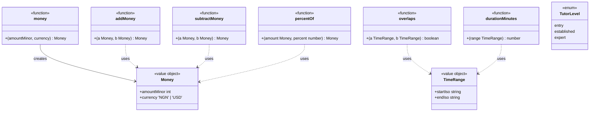

`libs/shared/domain/src/money.ts`, `time-range.ts`, `tutor-level.ts`. `Money` is an
integer count in the smallest unit (kobo/cents); `addMoney`, `subtractMoney`,
`percentOf`, `formatMoney` are the arithmetic helpers. `TutorLevel` is the
cross-cutting tier type shared by pricing, discovery, and tutor-performance — domains
depend on it via this lib instead of on each other.

---

## 2. shared/events — the event bus

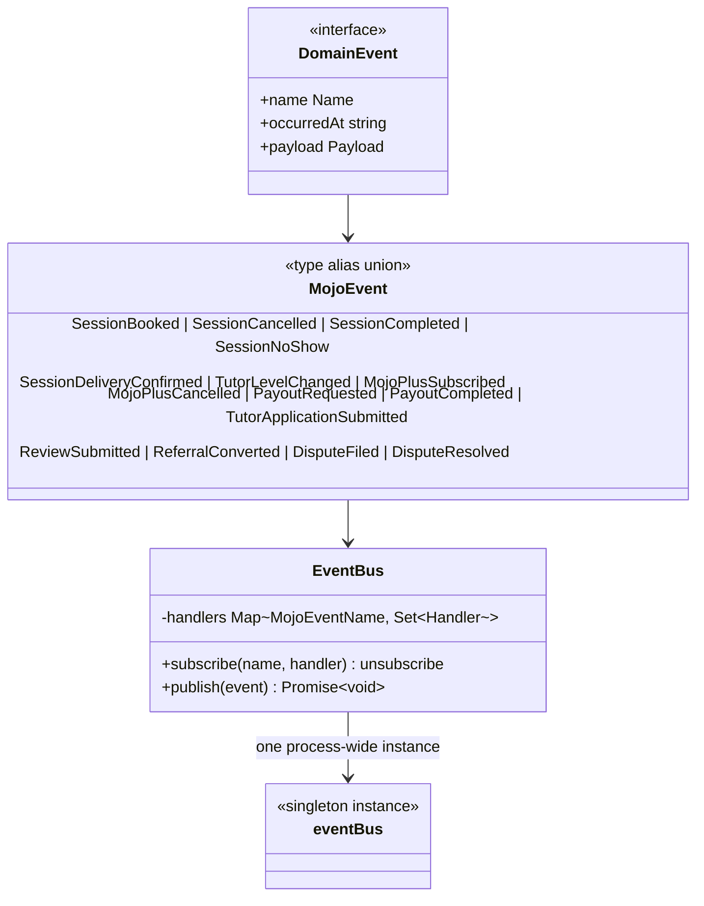

`EventBus` (`libs/shared/events/src/event-bus.ts`) is in-process pub/sub: modules
import the shared `eventBus` singleton rather than constructing their own, so a
publisher and a subscriber talk to the same bus within the single process. The full
15-event union is listed in [04-behavioral](04-behavioral.md#11-event-catalog-as-defined-in-code).

---

## 3. identity


`libs/identity`. Domain errors: `WeakPasswordError`, `EmailAlreadyRegisteredError`
(register), `InvalidCredentialsError`, `AccountSuspendedError` (authenticate).
Password policy (`password-policy.ts`): ≥10 chars, ≥1 uppercase, ≥1 digit, no
whitespace — unit-tested in `password-policy.spec.ts`; `makeAuthenticateUser` is
integration-tested in `authenticate-user.use-case.spec.ts` against in-memory fakes
of all three ports.

---

## 4. scheduling

```mermaid
classDiagram
    class AvailabilityRule {
        <<domain type>>
        +id string
        +tutorId string
        +weekday Weekday
        +startMinute int
        +endMinute int
    }
    class AvailabilityException {
        <<domain type>>
        +id string
        +tutorId string
        +date string
        +kind ExceptionKind
        +startMinute int
        +endMinute int
    }
    class SchedulingSettings {
        <<domain type>>
        +tutorId string
        +timezone string
        +bufferMinutes int
        +minimumNoticeMinutes int
        +pausedForNewBookings boolean
    }
    class ScheduledSession {
        <<domain type>>
        +id string
        +tutorId string
        +studentId string
        +startIso string
        +endIso string
        +status SessionStatus
        +isTrial boolean
        +statusHistory StatusEvent[]
    }
    class SessionStatus {
        <<enum>>
        booked
        confirmed
        completed
        cancelled
        no_show
    }
    class AvailabilityRepository {
        <<interface port>>
        +getRules(tutorId) Promise~AvailabilityRule[]~
        +getExceptions(tutorId, date) Promise~AvailabilityException[]~
        +getSettings(tutorId) Promise~SchedulingSettings~
    }
    class SessionRepository {
        <<interface port>>
        +getBookedSessions(tutorId, rangeStart, rangeEnd) Promise~ScheduledSession[]~
        +save(session) Promise~void~
        +findById(id) Promise~ScheduledSession|null~
    }
    class PrismaAvailabilityRepository {
        +prisma PrismaClient
        +getRules(tutorId) Promise~AvailabilityRule[]~
        +getExceptions(tutorId, date) Promise~AvailabilityException[]~
        +getSettings(tutorId) Promise~SchedulingSettings~
    }
    class PrismaSessionRepository {
        +prisma PrismaClient
        +getBookedSessions(tutorId, rangeStart, rangeEnd) Promise~ScheduledSession[]~
        +save(session) Promise~void~
        +findById(id) Promise~ScheduledSession|null~
    }
    class bookSession {
        <<use-case factory makeBookSession>>
        +(input BookSessionInput) Promise~ScheduledSession~
        +publishes SessionBooked
    }
    class cancelSession {
        <<use-case factory makeCancelSession>>
        +(input CancelSessionInput) Promise~void~
        +publishes SessionCancelled
    }
    class setAvailability {
        <<use-case factory makeSetAvailability>>
        +(tutorId, rules) Promise~void~
    }
    class hasConflict {
        <<pure function>>
        +(candidate TimeRange, existing) boolean
    }
    class withinNoticeWindow {
        <<pure function>>
        +(start, now, minimumNoticeMinutes) boolean
    }
    class respectsBuffer {
        <<pure function>>
        +(candidate, existing, bufferMinutes) boolean
    }
    PrismaAvailabilityRepository ..|> AvailabilityRepository
    PrismaSessionRepository ..|> SessionRepository
    bookSession --> AvailabilityRepository
    bookSession --> SessionRepository
    bookSession --> hasConflict
    bookSession --> withinNoticeWindow
    bookSession --> respectsBuffer
    cancelSession --> SessionRepository
    ScheduledSession --> SessionStatus
    AvailabilityException --> ExceptionKind : uses
    hasConflict ..> TimeRange : uses (from shared/domain)
```

`libs/scheduling`. Conflict/buffer/notice logic is pure and unit-tested
(`conflict-detection.spec.ts`); `makeBookSession` is integration-tested against
fakes and asserts the `SessionBooked` event is published
(`book-session.use-case.spec.ts`). `makeSetAvailability` is a placeholder that only
writes through a `save` callback — the read-only `AvailabilityRepository` port has
no write method today.

---

## 5. booking

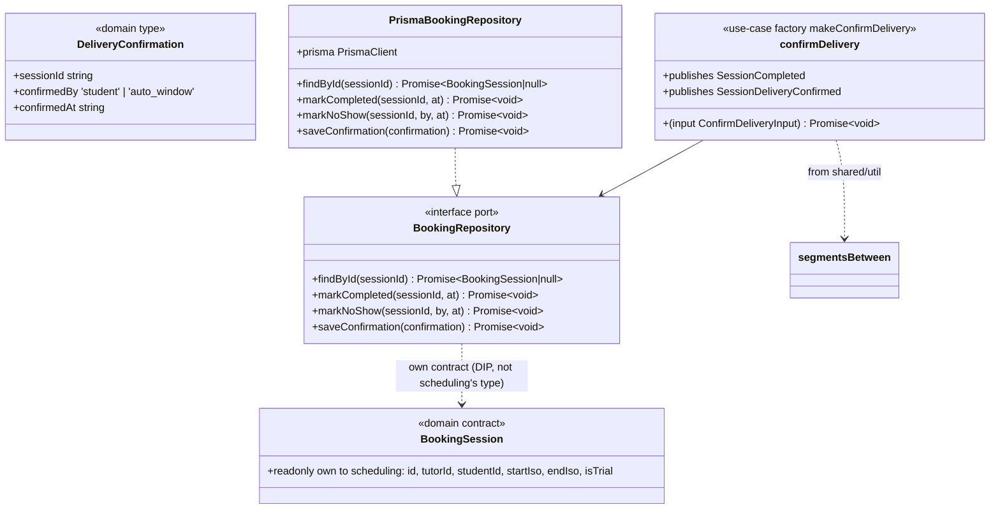

`libs/booking`. `AUTO_CONFIRM_WINDOW_HOURS = 48` is the constant referenced by the
roadmap's payout logic (`session-lifecycle.types.ts`). The `BookingRepository` port
returns booking's **own** `BookingSession` contract (`booking-session.types.ts`) —
dependency inversion: booking never imports scheduling's `ScheduledSession`; the
Prisma adapter projects the shared `Session` row into booking's shape.
`confirmDelivery` derives `segmentCount` via `segmentsBetween` (ceil-to-15-min) and
publishes both `SessionCompleted` and `SessionDeliveryConfirmed`. Domain error:
`SessionNotBookedError`. Tested in `confirm-delivery.use-case.spec.ts`.

---

## 6. pricing

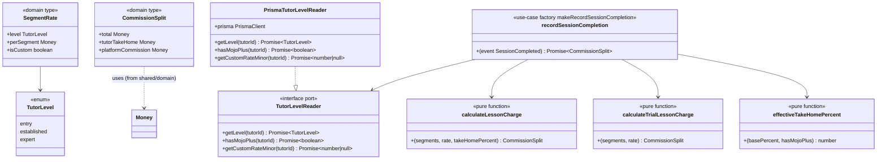

`libs/pricing`. Constants: `BASE_TAKE_HOME_PERCENT = { entry:50, established:60,
expert:70 }`, `MOJO_PLUS_BONUS_PERCENT = 10`, `DEFAULT_SEGMENT_RATE_NGN =
{ entry:400000, established:600000, expert:800000 }` (kobo). `TutorLevel` and `Money`
are defined in `@mojo/shared/domain` (pricing imports and re-exports them) so
`discovery`/`tutor-performance` share them without importing pricing. This is the
pure, I/O-free Phase 2 monetization model called out in `mojo-roadmap.md`; fully
unit-tested in `calculate-lesson-charge.spec.ts` and
`record-session-completion.use-case.spec.ts`.

---

## 7. payments

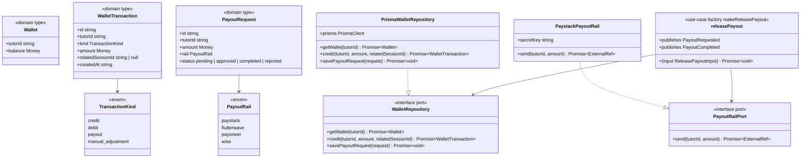

`libs/payments`. Domain error: `InsufficientBalanceError`. `releasePayout` publishes
`PayoutRequested` before calling the rail and `PayoutCompleted` after; tested in
`release-payout.use-case.spec.ts`. `PrismaWalletRepository.credit` is a
`$transaction` (wallet increment + ledger row).

---

## 8. mojo-plus


`libs/mojo-plus`. Domain error: `MojoPlusRequiredError` (custom pricing requires an
active subscription). All three use-cases are test-covered
(`subscribe-mojo-plus.use-case.spec.ts`). **No infrastructure layer** exists for this
module — persistence is an interface only.

---

## 9. lab

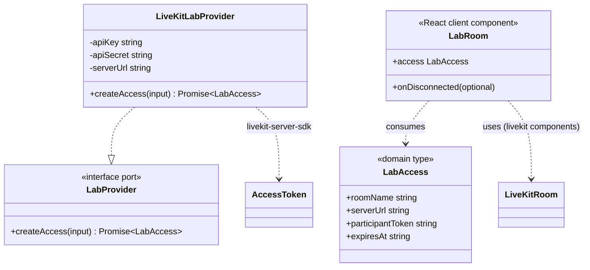

`libs/lab`. Room name derives deterministically from the session id
(`mojo-session-<sessionId>`); token TTL is 3h. Tested in
`livekit-lab.adapter.spec.ts`. `apps/hub/app/(tutor)/lab/[sessionId]/page.tsx`
constructs `LiveKitLabProvider` from env and renders `LabRoom`.

---

## 10. shared/ui and shared/util


`libs/shared/ui` (`button.tsx`, `badge.tsx`, `card.tsx`, `input.tsx`, `alert.tsx`,
`index.ts`) exports these five design-system primitives; `libs/shared/util`
(`cn.ts`, `date.ts`) provides `cn` (clsx + tailwind-merge), timezone helpers, and
`segmentsBetween`.

---

## 11. Previously-scaffold modules — now full-depth

The twelve modules that were scaffold-depth are now full-depth: each has a `domain`
ports file + types, an `application/` use-case layer, `infrastructure/` Prisma
adapters, and Vitest specs. Per `eslint.config.mjs`, the only cross-module
dependency allowed in code is `discovery → @mojo/pricing/domain` (the rate
contract); every module otherwise depends only on the shared libs (`@mojo/shared/*`)
and communicates cross-module via the event bus — `booking` and `tutor-performance`
formerly coupled to `scheduling`/`pricing` were decoupled via dependency inversion
(`BookingSession` contract, `TutorLevel` promoted to `shared/domain`).

### 11.1 tutor-profile

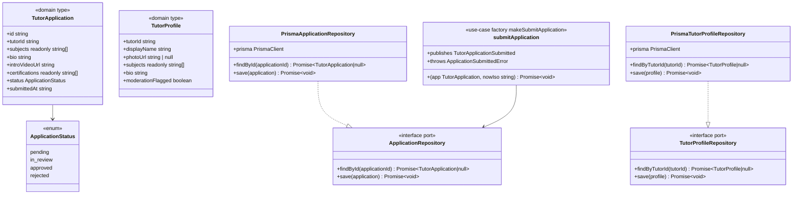

`libs/tutor-profile`. `submitApplication` rejects duplicates with
`ApplicationSubmittedError` then publishes `TutorApplicationSubmitted`
(`{ applicationId, tutorId }`); tested in `submit-application.use-case.spec.ts`.

### 11.2 tutor-performance

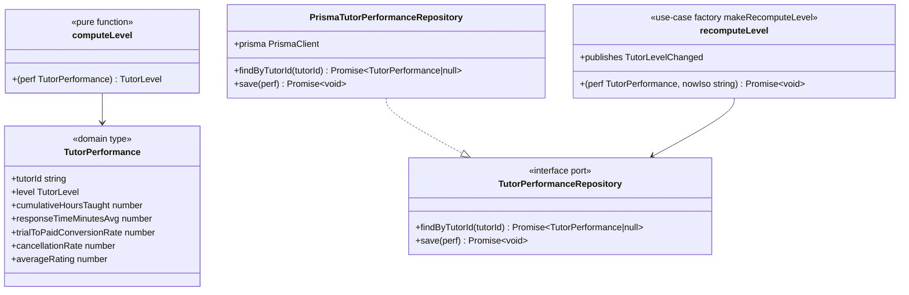

`libs/tutor-performance`. `computeLevel` is a pure function gated on
`LEVEL_THRESHOLDS` (established 50h/4.5, expert 200h/4.7); `recomputeLevel` persists
and publishes `TutorLevelChanged` only when the level changes. The `TutorLevel` value
object comes from `@mojo/shared/domain` — tutor-performance has no dependency on
pricing (layering: domain imports only shared).

### 11.3 discovery

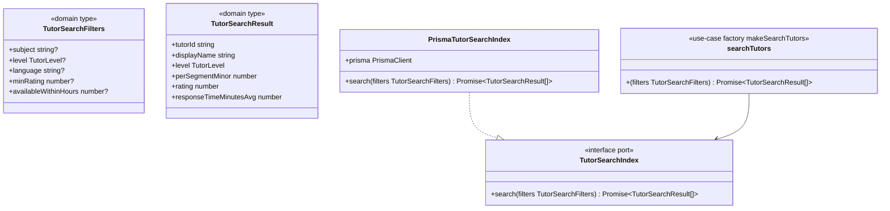

`libs/discovery`. `searchTutors` delegates to the `TutorSearchIndex` port; the
`PrismaTutorSearchIndex` joins `TutorProfile` + `TutorPerformance` in JS by `tutorId`
and applies subject/level/minRating (note: `language` and `availableWithinHours`
have no persisted column, so are not applied — documented in code). `TutorLevel`
comes from `@mojo/shared/domain`; only `DEFAULT_SEGMENT_RATE_NGN` still comes from
`@mojo/pricing/domain` — the rate contract discovery's infrastructure reads at
query time (boundary: discovery/infrastructure → pricing/domain, the sole
cross-module dependency in the tree).

### 11.4 billing

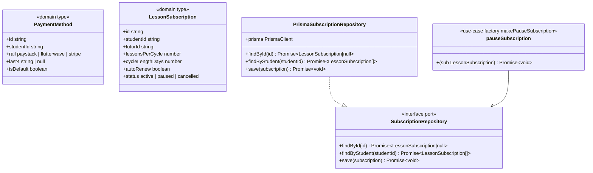

`libs/billing`. `pauseSubscription` saves a `LessonSubscription` with status `paused`;
tested in `manage-subscription.use-case.spec.ts`.

### 11.5 messaging

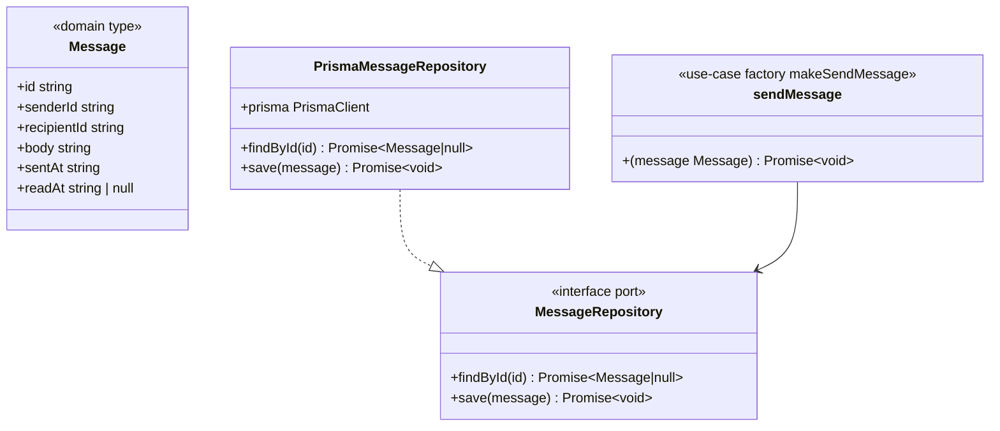

`libs/messaging`. `sendMessage` persists a `Message`; tested in
`send-message.use-case.spec.ts`.

### 11.6 reviews

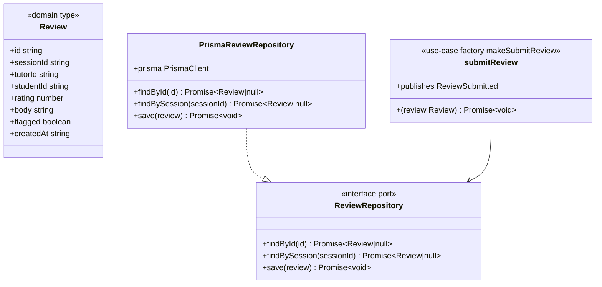

`libs/reviews`. `submitReview` persists and publishes `ReviewSubmitted`
(`{ sessionId, tutorId, rating }`); tested in `submit-review.use-case.spec.ts`.

### 11.7 referrals

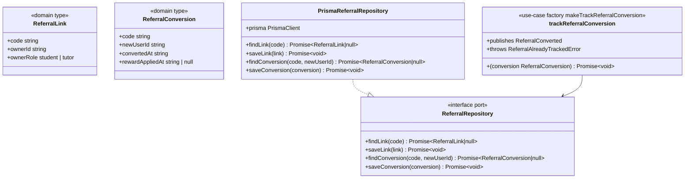

`libs/referrals`. `trackReferralConversion` rejects duplicates with
`ReferralAlreadyTrackedError` then publishes `ReferralConverted`
(`{ code, newUserId }`); tested in `track-referral.use-case.spec.ts`.

### 11.8 trust-safety

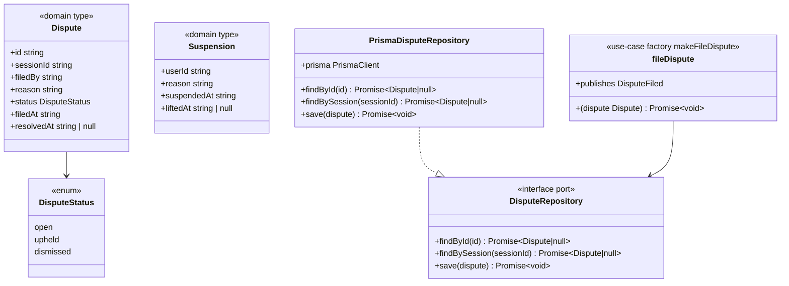

`libs/trust-safety`. `fileDispute` persists a `Dispute` and publishes `DisputeFiled`
(`{ sessionId, filedBy, reason }`); tested in `file-dispute.use-case.spec.ts`.

### 11.9 ai-learning

```mermaid
classDiagram
    class LessonRecap {
        <<domain type>>
        +sessionId string
        +summary string
        +focusAreas readonly string[]
        +generatedAt string
        +reviewedByTutor boolean
    }
    class PracticeItem {
        <<domain type>>
        +id string
        +sessionId string
        +studentId string
        +kind daily_exercise | scenario_drill
        +prompt string
        +completedAt string | null
    }
    class TranscriptSummarizer {
        <<interface port outbound>>
        +summarize(transcript string) Promise~{summary string; focusAreas string[]}~
    }
    class RecapRepository {
        <<interface port>>
        +findBySession(sessionId) Promise~LessonRecap|null~
        +save(recap) Promise~void~
    }
    class PrismaRecapRepository {
        +prisma PrismaClient
        +findBySession(sessionId) Promise~LessonRecap|null~
        +save(recap) Promise~void~
    }
    class generateRecap {
        <<use-case factory makeGenerateRecap>>
        +(sessionId string, transcript string, nowIso string) Promise~LessonRecap~
        +throws DuplicateRecapError
    }
    PrismaRecapRepository ..|> RecapRepository
    generateRecap --> RecapRepository
    generateRecap --> TranscriptSummarizer
```

`libs/ai-learning`. `generateRecap` is triggered externally on `SessionCompleted` at
the composition root; it calls the `TranscriptSummarizer`, rejects a second recap for
the same session with `DuplicateRecapError`, then persists via `RecapRepository`;
tested in `generate-recap.use-case.spec.ts`.

### 11.10 notifications

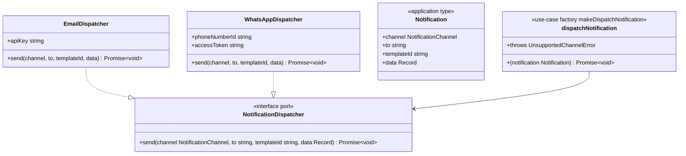

`libs/notifications`. A five-layer addition brought in the missing `application/`
layer: `makeDispatchNotification({ dispatchers })` routes a `Notification` to the
adapter registered for its channel (email/whatsapp), throwing
`UnsupportedChannelError` when none matches. `EmailDispatcher` → Resend, `WhatsAppDispatcher`
→ WhatsApp Business Cloud API; tested in `dispatch-notification.use-case.spec.ts`.

### 11.11 admin-config

```mermaid
classDiagram
    class FeatureFlag {
        <<domain type>>
        +key string
        +enabled boolean
        +rolloutPercent number
    }
    class AuditLogEntry {
        <<domain type>>
        +id string
        +adminId string
        +action string
        +targetId string | null
        +at string
    }
    class SubjectTaxonomyEntry {
        <<domain type>>
        +id string
        +name string
        +parentId string | null
    }
    class FeatureFlagRepository {
        <<interface port>>
        +findByKey(key) Promise~FeatureFlag|null~
        +list() Promise~FeatureFlag[]~
        +save(flag) Promise~void~
    }
    class AuditLogRepository {
        <<interface port>>
        +append(entry) Promise~void~
    }
    class SubjectTaxonomyRepository {
        <<interface port>>
        +list() Promise~SubjectTaxonomyEntry[]~
        +save(entry) Promise~void~
    }
    class PrismaFeatureFlagRepository {
        +findByKey(key) Promise~FeatureFlag|null~
        +list() Promise~FeatureFlag[]~
        +save(flag) Promise~void~
    }
    class PrismaAuditLogRepository {
        +append(entry) Promise~void~
    }
    class PrismaSubjectTaxonomyRepository {
        +list() Promise~SubjectTaxonomyEntry[]~
        +save(entry) Promise~void~
    }
    class setFeatureFlag {
        <<use-case factory makeSetFeatureFlag>>
        +(input FeatureFlag) Promise~void~
        +throws InvalidRolloutPercentError
    }
    class appendAuditLog {
        <<use-case factory makeAppendAuditLog>>
        +(entry AuditLogEntry) Promise~void~
    }
    class listSubjects {
        <<use-case factory makeListSubjects>>
        +() Promise~SubjectTaxonomyEntry[]~
    }
    PrismaFeatureFlagRepository ..|> FeatureFlagRepository
    PrismaAuditLogRepository ..|> AuditLogRepository
    PrismaSubjectTaxonomyRepository ..|> SubjectTaxonomyRepository
    setFeatureFlag --> FeatureFlagRepository
    appendAuditLog --> AuditLogRepository
    listSubjects --> SubjectTaxonomyRepository
```

`libs/admin-config`. Three use-cases: `setFeatureFlag` (rejects
`rolloutPercent` outside 0–100 with `InvalidRolloutPercentError`), `appendAuditLog`,
and `listSubjects`, each backed by a Prisma adapter; tested in
`admin-config.use-cases.spec.ts`.

### 11.12 analytics

```mermaid
classDiagram
    class PlatformMetrics {
        <<domain type>>
        +gmvMinor number
        +activeTutors number
        +activeStudents number
        +trialToPaidConversionRate number
        +asOf string
    }
    class TutorLeaderboardEntry {
        <<domain type>>
        +tutorId string
        +displayName string
        +responseTimeMinutesAvg number
        +cancellationRate number
        +rank number
    }
    class LeaderboardCandidate {
        <<domain type>>
        +tutorId string
        +displayName string
        +responseTimeMinutesAvg number
        +cancellationRate number
    }
    class AnalyticsRepository {
        <<interface port>>
        +countActiveTutors() Promise~number~
        +countActiveStudents() Promise~number~
        +sumWalletCreditsMinor() Promise~number~
        +listLeaderboardCandidates() Promise~LeaderboardCandidate[]~
    }
    class PrismaAnalyticsRepository {
        +countActiveTutors() Promise~number~
        +countActiveStudents() Promise~number~
        +sumWalletCreditsMinor() Promise~number~
        +listLeaderboardCandidates() Promise~LeaderboardCandidate[]~
    }
    class computePlatformMetrics {
        <<use-case factory makeComputePlatformMetrics>>
        +(nowIso string) Promise~PlatformMetrics~
    }
    class buildLeaderboard {
        <<use-case factory makeBuildLeaderboard>>
        +(limit number) Promise~TutorLeaderboardEntry[]~
    }
    PrismaAnalyticsRepository ..|> AnalyticsRepository
    computePlatformMetrics --> AnalyticsRepository
    buildLeaderboard --> AnalyticsRepository
```

`libs/analytics`. `computePlatformMetrics` aggregates GMV (sum of wallet credits),
active tutors/students (User counts by role), and sets `trialToPaidConversionRate: 0`
(a true cohort rate is not yet derived — documented in code); `buildLeaderboard`
sorts candidates by response time then cancellation rate, caps at `limit`, and
assigns ranks; tested in `analytics.use-cases.spec.ts`.
