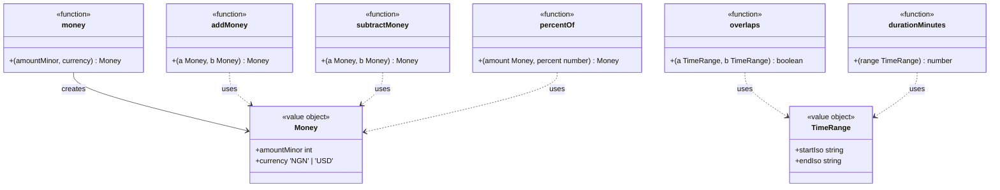
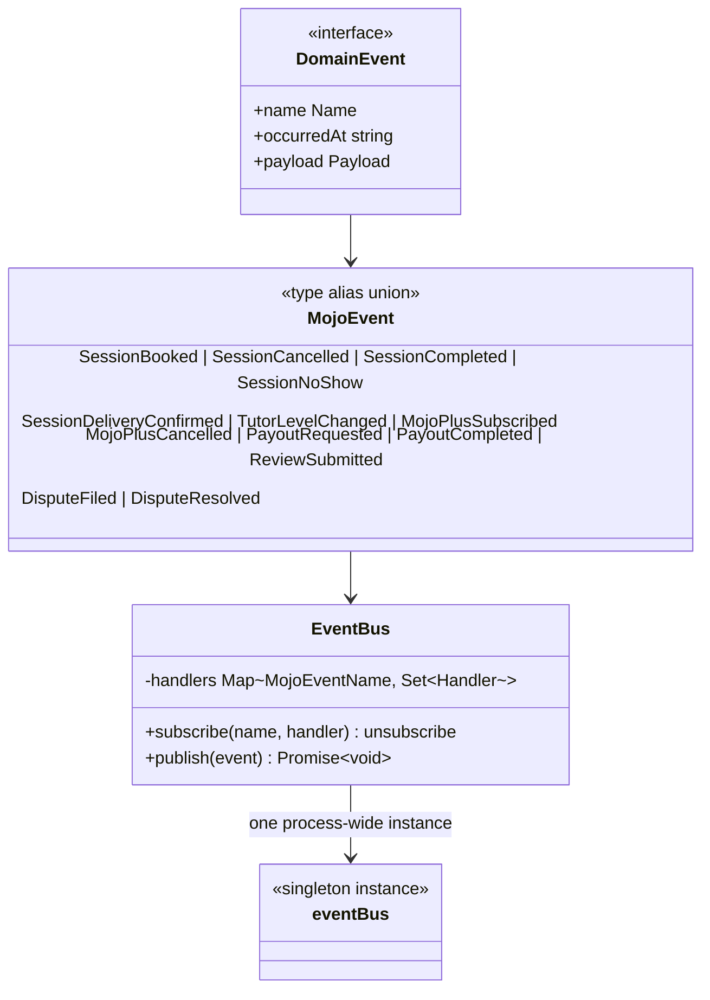
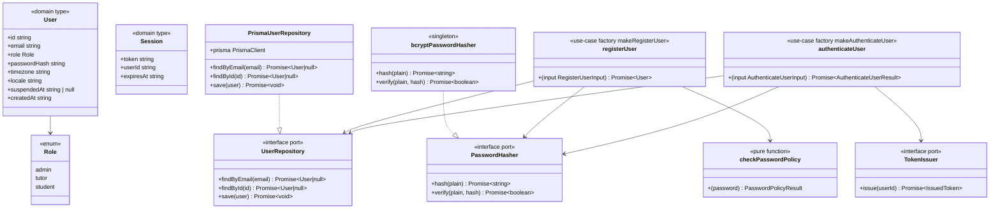
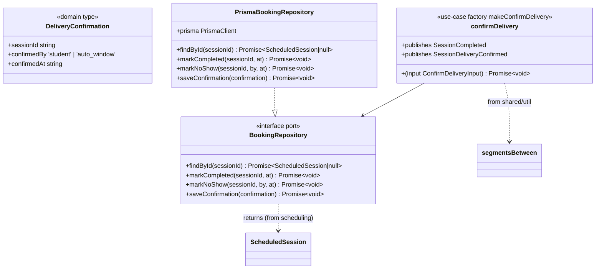
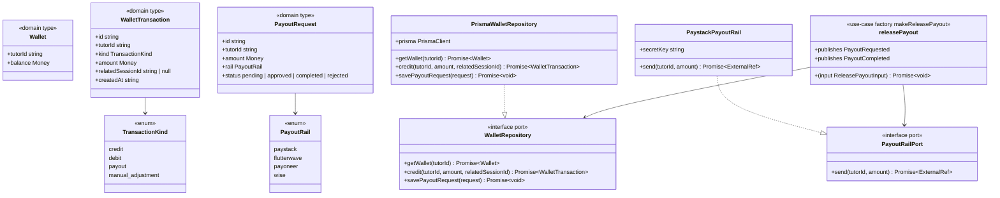
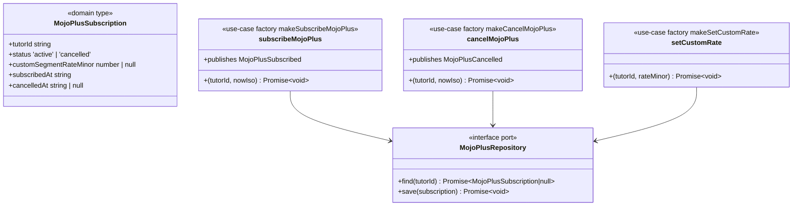
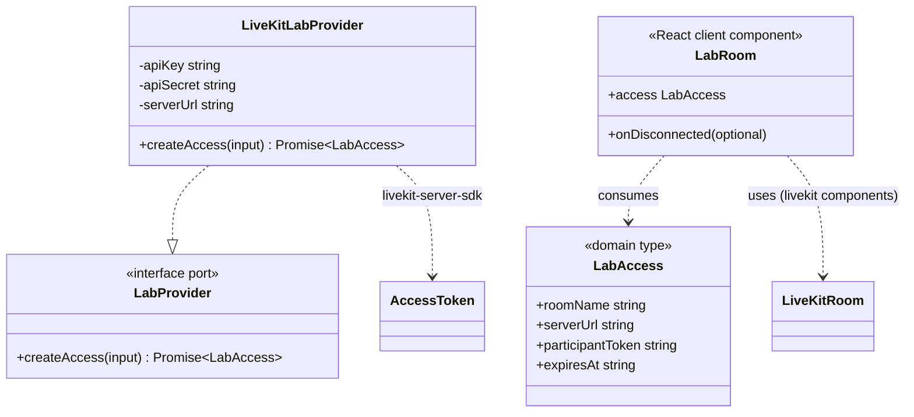
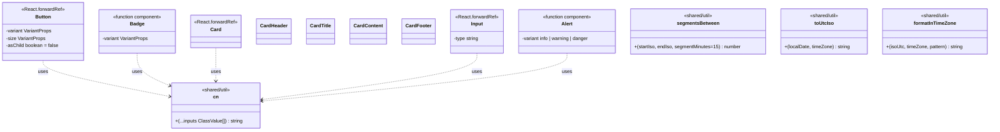

# Mojo — 02. Class Diagrams

The object/type structure of each implemented module. Because Mojo is TypeScript
with **ports** (interfaces) and **use-case factory functions** rather than
traditional inheritance, the diagrams below mix:

- **`<<interface>>` ports** — defined in a module's `domain/`, implemented by `infrastructure/`
- **`<<class>>` infrastructure adapters** — the only place Prisma/SDK imports live
- **`<<function>>` use-case factories** (`make*`) — the `application/` layer
- **pure functions** and **value objects** from `domain/`
- **`<<scaffold>>`** — modules at domain-type depth only

Mermaid `classDiagram` has no native "function returns a function API" concept, so
factories are drawn as classes exposing their returned use-case method; the
`make*` factory is named on the class via a note where relevant.

Full-depth modules are documented in detail. Scaffold modules are documented
compactly. See `assets/uml/README.md` for the depth legend.

---

## 1. shared/domain — cross-module value objects



`libs/shared/domain/src/money.ts`, `time-range.ts`. `Money` is always an integer
count in the smallest unit (kobo/cents); `addMoney`, `subtractMoney`, `percentOf`,
`formatMoney` are the arithmetic helpers.

---

## 2. shared/events — the event bus



`EventBus` (`libs/shared/events/src/event-bus.ts`) is in-process pub/sub: modules
import the shared `eventBus` singleton rather than constructing their own, so a
publisher and a subscriber talk to the same bus within the single process. The full
12-event union is listed in [04-behavioral](04-behavioral.md#11-event-catalog-as-defined-in-code).

---

## 3. identity



`libs/identity`. Domain errors: `WeakPasswordError`, `EmailAlreadyRegisteredError`
(register), `InvalidCredentialsError`, `AccountSuspendedError` (authenticate).
Password policy (`password-policy.ts`): ≥10 chars, ≥1 uppercase, ≥1 digit, no
whitespace — unit-tested in `password-policy.spec.ts`; `makeAuthenticateUser` is
integration-tested in `authenticate-user.use-case.spec.ts` against in-memory fakes
of all three ports.

---

## 4. scheduling


`libs/scheduling`. Conflict/buffer/notice logic is pure and unit-tested
(`conflict-detection.spec.ts`); `makeBookSession` is integration-tested against
fakes and asserts the `SessionBooked` event is published
(`book-session.use-case.spec.ts`). `makeSetAvailability` is a placeholder that only
writes through a `save` callback — the read-only `AvailabilityRepository` port has
no write method today.

---

## 5. booking



`libs/booking`. `AUTO_CONFIRM_WINDOW_HOURS = 48` is the constant referenced by the
roadmap's payout logic (`session-lifecycle.types.ts`). `confirmDelivery` derives
`segmentCount` via `segmentsBetween` (ceil-to-15-min) and publishes both
`SessionCompleted` and `SessionDeliveryConfirmed`. Domain error: `SessionNotBookedError`.
Tested in `confirm-delivery.use-case.spec.ts`.

---

## 6. pricing


`libs/pricing`. Constants: `BASE_TAKE_HOME_PERCENT = { entry:50, established:60,
expert:70 }`, `MOJO_PLUS_BONUS_PERCENT = 10`, `DEFAULT_SEGMENT_RATE_NGN =
{ entry:400000, established:600000, expert:800000 }` (kobo). This is the pure,
I/O-free Phase 2 monetization model called out in `mojo-roadmap.md`; fully
unit-tested in `calculate-lesson-charge.spec.ts` and
`record-session-completion.use-case.spec.ts`.

---

## 7. payments



`libs/payments`. Domain error: `InsufficientBalanceError`. `releasePayout` publishes
`PayoutRequested` before calling the rail and `PayoutCompleted` after; tested in
`release-payout.use-case.spec.ts`. `PrismaWalletRepository.credit` is a
`$transaction` (wallet increment + ledger row).

---

## 8. mojo-plus



`libs/mojo-plus`. Domain error: `MojoPlusRequiredError` (custom pricing requires an
active subscription). All three use-cases are test-covered
(`subscribe-mojo-plus.use-case.spec.ts`). **No infrastructure layer** exists for this
module — persistence is an interface only.

---

## 9. lab



`libs/lab`. Room name derives deterministically from the session id
(`mojo-session-<sessionId>`); token TTL is 3h. Tested in
`livekit-lab.adapter.spec.ts`. `apps/hub/app/(tutor)/lab/[sessionId]/page.tsx`
constructs `LiveKitLabProvider` from env and renders `LabRoom`.

---

## 10. shared/ui and shared/util



`libs/shared/ui` (`button.tsx`, `badge.tsx`, `card.tsx`, `input.tsx`, `alert.tsx`,
`index.ts`) exports these five design-system primitives; `libs/shared/util`
(`cn.ts`, `date.ts`) provides `cn` (clsx + tailwind-merge), timezone helpers, and
`segmentsBetween`.

---

## 11. Scaffold-depth modules (domain types + one thin use-case each)

```mermaid
classDiagram
    namespace tutor-profile {
        class TutorApplication {
            <<scaffold>>
            +id string
            +tutorId string
            +subjects string[]
            +bio string
            +introVideoUrl string
            +certifications string[]
            +status ApplicationStatus
            +submittedAt string
        }
        class TutorProfile {
            <<scaffold>>
            +tutorId string
            +displayName string
            +photoUrl string
            +subjects string[]
            +bio string
            +moderationFlagged boolean
        }
        class ApplicationStatus {
            <<scaffold enum>>
            +pending
            +in_review
            +approved
            +rejected
        }
        class submitApplication {
            <<scaffold use-case>>
            +(app TutorApplication) void
        }
        submitApplication --> TutorApplication
        TutorApplication --> ApplicationStatus
    }
    namespace tutor-performance {
        class TutorPerformance {
            <<scaffold>>
            +tutorId string
            +level TutorLevel
            +cumulativeHoursTaught number
            +responseTimeMinutesAvg number
            +trialToPaidConversionRate number
            +cancellationRate number
            +averageRating number
        }
        class computeLevel {
            <<scaffold pure>>
            +(perf TutorPerformance) TutorLevel
        }
        class recomputeLevel {
            <<scaffold use-case>>
            +(perf TutorPerformance, nowIso string) void
            +publishes TutorLevelChanged
        }
        computeLevel --> TutorPerformance
        recomputeLevel --> TutorPerformance
    }
    namespace discovery {
        class TutorSearchFilters {
            <<scaffold>>
            +subject string
            +level TutorLevel
            +language string
            +minRating number
            +availableWithinHours number
        }
        class TutorSearchResult {
            <<scaffold>>
            +tutorId string
            +displayName string
            +level TutorLevel
            +perSegmentMinor number
            +rating number
            +responseTimeMinutesAvg number
        }
        class searchTutors {
            <<scaffold use-case>>
            +(filters TutorSearchFilters) TutorSearchResult[]
        }
        searchTutors --> TutorSearchFilters
    }
    namespace billing {
        class PaymentMethod {
            <<scaffold>>
            +id string
            +studentId string
            +rail string
            +last4 string
            +isDefault boolean
        }
        class LessonSubscription {
            <<scaffold>>
            +id string
            +studentId string
            +tutorId string
            +lessonsPerCycle number
            +cycleLengthDays number
            +autoRenew boolean
            +status string
        }
        class pauseSubscription {
            <<scaffold use-case>>
            +(sub LessonSubscription) void
        }
        pauseSubscription --> LessonSubscription
    }
    namespace messaging {
        class Message {
            <<scaffold>>
            +id string
            +senderId string
            +recipientId string
            +body string
            +sentAt string
            +readAt string
        }
        class sendMessage {
            <<scaffold use-case>>
            +(message Message) void
        }
        sendMessage --> Message
    }
    namespace reviews {
        class Review {
            <<scaffold>>
            +id string
            +sessionId string
            +tutorId string
            +studentId string
            +rating number
            +body string
            +flagged boolean
            +createdAt string
        }
        class submitReview {
            <<scaffold use-case>>
            +(review Review) void
            +publishes ReviewSubmitted
        }
        submitReview --> Review
    }
    namespace referrals {
        class ReferralLink {
            <<scaffold>>
            +code string
            +ownerId string
            +ownerRole string
        }
        class ReferralConversion {
            <<scaffold>>
            +code string
            +newUserId string
            +convertedAt string
            +rewardAppliedAt string
        }
        class trackReferralConversion {
            <<scaffold use-case>>
            +(conversion ReferralConversion) void
        }
        trackReferralConversion --> ReferralConversion
    }
    namespace trust-safety {
        class Dispute {
            <<scaffold>>
            +id string
            +sessionId string
            +filedBy string
            +reason string
            +status DisputeStatus
            +filedAt string
            +resolvedAt string
        }
        class Suspension {
            <<scaffold>>
            +userId string
            +reason string
            +suspendedAt string
            +liftedAt string
        }
        class fileDispute {
            <<scaffold use-case>>
            +(dispute Dispute) void
            +publishes DisputeFiled
        }
        fileDispute --> Dispute
    }
    namespace ai-learning {
        class LessonRecap {
            <<scaffold>>
            +sessionId string
            +summary string
            +focusAreas string[]
            +generatedAt string
            +reviewedByTutor boolean
        }
        class PracticeItem {
            <<scaffold>>
            +id string
            +sessionId string
            +studentId string
            +kind string
            +prompt string
            +completedAt string
        }
        class generateRecap {
            <<scaffold use-case>>
            +(sessionId string, transcript string, nowIso string) LessonRecap
        }
        generateRecap --> LessonRecap
    }
    namespace notifications {
        class NotificationDispatcher {
            <<scaffold interface>>
            +send(channel, to, templateId, data) void
        }
        class EmailDispatcher {
            <<scaffold adapter Resend>>
            +send(channel, to, templateId, data) void
        }
        class WhatsAppDispatcher {
            <<scaffold adapter WhatsApp>>
            +send(channel, to, templateId, data) void
        }
        EmailDispatcher ..|> NotificationDispatcher
        WhatsAppDispatcher ..|> NotificationDispatcher
    }
    namespace admin-config {
        class FeatureFlag {
            <<scaffold>>
            +key string
            +enabled boolean
            +rolloutPercent number
        }
        class AuditLogEntry {
            <<scaffold>>
            +id string
            +adminId string
            +action string
            +targetId string
            +at string
        }
        class SubjectTaxonomyEntry {
            <<scaffold>>
            +id string
            +name string
            +parentId string
        }
    }
    namespace analytics {
        class PlatformMetrics {
            <<scaffold>>
            +gmvMinor number
            +activeTutors number
            +activeStudents number
            +trialToPaidConversionRate number
            +asOf string
        }
        class TutorLeaderboardEntry {
            <<scaffold>>
            +tutorId string
            +displayName string
            +responseTimeMinutesAvg number
            +cancellationRate number
            +rank number
        }
    }
```

Scaffold detail (from source, all `<<scaffold>>`):

- **tutor-profile** — `submit-application.use-case.ts` saves a `TutorApplication`.
  TODO comment: publish `TutorApplicationSubmitted` once the events catalog has it.
- **tutor-performance** — `computeLevel` (pure: gate on hours + rating floor) and
  `recomputeLevel` publishes `TutorLevelChanged`; never written to directly (built
  from events per the modular-monolith doc). `LEVEL_THRESHOLDS =
  { established: {hours:50, minRating:4.5}, expert: {hours:200, minRating:4.7} }`.
- **discovery** — `searchTutors` delegates to a `TutorSearchIndex` port.
- **billing** — `makePauseSubscription` toggles a `LessonSubscription` to `paused`.
- **messaging** — `makeSendMessage` saves a `Message` through a `MessageRepository`.
- **reviews** — `submitReview` saves + publishes `ReviewSubmitted`.
- **referrals** — `trackReferralConversion` saves only; TODO to publish
  `ReferralConverted` (not in catalog).
- **trust-safety** — `fileDispute` saves + publishes `DisputeFiled`.
- **ai-learning** — `generateRecap` (fires on `SessionCompleted` at composition root)
  depends on a `TranscriptSummarizer` port.
- **notifications** — domain `NotificationDispatcher` interface + two infra adapters
  (`EmailDispatcher`, `WhatsAppDispatcher`); **no application layer**.
- **admin-config** — domain types only (`FeatureFlag`, `AuditLogEntry`,
  `SubjectTaxonomyEntry`).
- **analytics** — domain types only (`PlatformMetrics`, `TutorLeaderboardEntry`).
