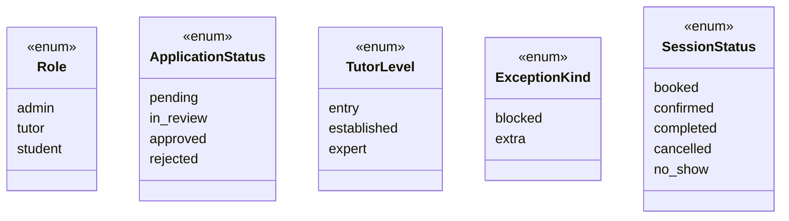

# Mojo — 03. Data Model

The persistence model is a **single consolidated Postgres schema**
(`prisma/schema.prisma`). Mojo deliberately uses one database with one schema file
across all modules — a modular monolith — rather than a database per module; module
boundaries are enforced in code, not by splitting storage (see
[`docs/mojo-modules.md`](../mojo-modules.md)).

This document is generated from the actual schema: 23 models, 6 enums, and every
relation/cardinality as declared.

---

## 1. Entity–relationship diagram

```mermaid
erDiagram
    USER ||--o| TUTOR_PROFILE : "tutorProfile"
    USER ||--o| TUTOR_PERFORMANCE : "tutorPerf"
    USER ||--o| WALLET : "wallet"
    USER ||--o| SCHEDULING_SETTINGS : "schedulingCfg"
    USER ||--o{ SESSION : "tutor (TutorSessions)"
    USER ||--o{ SESSION : "student (StudentSessions)"
    USER ||--o{ REVIEW : "author (ReviewAuthor)"
    USER ||--o{ AUDIT_LOG_ENTRY : "admin"
    USER ||--o{ TUTOR_APPLICATION : "submits"

    SESSION ||--o{ SESSION_STATUS_EVENT : "statusHistory"
    SESSION ||--o| DELIVERY_CONFIRMATION : "deliveryConfirmation"
    SESSION ||--o| REVIEW : "review"
    SESSION ||--o| DISPUTE : "dispute"

    WALLET ||--o{ WALLET_TRANSACTION : "transactions"

    USER {
        string id PK
        string email UK
        Role role
        string passwordHash
        string timezone
        string locale
        DateTime suspendedAt
        DateTime createdAt
    }
    TUTOR_APPLICATION {
        string id PK
        string tutorId
        string subjects
        string bio
        string introVideoUrl
        string certifications
        ApplicationStatus status
        DateTime submittedAt
    }
    TUTOR_PROFILE {
        string tutorId PK,FK
        string displayName
        string photoUrl
        string subjects
        string bio
        boolean moderationFlagged
    }
    TUTOR_PERFORMANCE {
        string tutorId PK,FK
        TutorLevel level
        float cumulativeHoursTaught
        float responseTimeMinutesAvg
        float trialToPaidConversionRate
        float cancellationRate
        float averageRating
        DateTime updatedAt
    }
    MOJO_PLUS_SUBSCRIPTION {
        string tutorId PK
        string status
        int customSegmentRateMinor
        DateTime subscribedAt
        DateTime cancelledAt
    }
    AVAILABILITY_RULE {
        string id PK
        string tutorId
        int weekday
        int startMinute
        int endMinute
    }
    AVAILABILITY_EXCEPTION {
        string id PK
        string tutorId
        string date
        ExceptionKind kind
        int startMinute
        int endMinute
    }
    SCHEDULING_SETTINGS {
        string tutorId PK,FK
        string timezone
        int bufferMinutes
        int minimumNoticeMinutes
        boolean pausedForNewBookings
    }
    SESSION {
        string id PK
        string tutorId FK
        string studentId FK
        DateTime startAt
        DateTime endAt
        SessionStatus status
        boolean isTrial
        DateTime createdAt
    }
    SESSION_STATUS_EVENT {
        string id PK
        string sessionId FK
        SessionStatus status
        DateTime at
    }
    DELIVERY_CONFIRMATION {
        string sessionId PK,FK
        string confirmedBy
        DateTime confirmedAt
    }
    WALLET {
        string tutorId PK,FK
        int balanceMinor
    }
    WALLET_TRANSACTION {
        string id PK
        string tutorId FK
        string kind
        int amountMinor
        string relatedSessionId
        DateTime createdAt
    }
    PAYOUT_REQUEST {
        string id PK
        string tutorId
        int amountMinor
        string rail
        string status
        DateTime requestedAt
    }
    PAYMENT_METHOD {
        string id PK
        string studentId
        string rail
        string last4
        boolean isDefault
    }
    LESSON_SUBSCRIPTION {
        string id PK
        string studentId
        string tutorId
        int lessonsPerCycle
        int cycleLengthDays
        boolean autoRenew
        string status
    }
    MESSAGE {
        string id PK
        string senderId
        string recipientId
        string body
        DateTime sentAt
        DateTime readAt
    }
    REVIEW {
        string id PK
        string sessionId UK,FK
        string tutorId
        string studentId FK
        int rating
        string body
        boolean flagged
        DateTime createdAt
    }
    REFERRAL_LINK {
        string code PK
        string ownerId
        string ownerRole
    }
    REFERRAL_CONVERSION {
        string id PK
        string code
        string newUserId
        DateTime convertedAt
        DateTime rewardAppliedAt
    }
    DISPUTE {
        string id PK
        string sessionId UK,FK
        string filedBy
        string reason
        string status
        DateTime filedAt
        DateTime resolvedAt
    }
    LESSON_RECAP {
        string sessionId PK
        string summary
        string focusAreas
        DateTime generatedAt
        boolean reviewedByTutor
    }
    PRACTICE_ITEM {
        string id PK
        string sessionId
        string studentId
        string kind
        string prompt
        DateTime completedAt
    }
    FEATURE_FLAG {
        string key PK
        boolean enabled
        int rolloutPercent
    }
    AUDIT_LOG_ENTRY {
        string id PK
        string adminId FK
        string action
        string targetId
        DateTime at
    }
    SUBJECT_TAXONOMY_ENTRY {
        string id PK
        string name
        string parentId
    }
```

**Legend:** `PK` primary key · `FK` foreign key · `UK` unique · `o{`/`o|` = optional ·
`||` = exactly one · `|{`/`}{` = many.

---

## 2. Enums

---

## 3. Model inventory by owning module

| Model | Domain owns | Backing repository in code? | Kind |
|---|---|---|---|
| `User` | identity | ✅ `PrismaUserRepository` | full-depth |
| `TutorApplication` | tutor-profile | ✅ `PrismaApplicationRepository` | full-depth |
| `TutorProfile` | tutor-profile | ✅ `PrismaApplicationRepository` (read); `PrismaAnalyticsRepository` (read) | full-depth |
| `TutorPerformance` | tutor-performance / pricing (level) | ✅ `PrismaTutorPerformanceRepository`; level read by `PrismaTutorLevelReader` (pricing) | full-depth |
| `MojoPlusSubscription` | mojo-plus | ❌ no own infra — read by `PrismaTutorLevelReader` (pricing) | full-depth types |
| `AvailabilityRule` | scheduling | ✅ `PrismaSchedulingRepository` (read) | full-depth |
| `AvailabilityException` | scheduling | ✅ (read) | full-depth |
| `SchedulingSettings` | scheduling | ✅ (read) | full-depth |
| `Session` | scheduling / booking | ✅ `PrismaSchedulingRepository` and `PrismaBookingRepository` | full-depth |
| `SessionStatusEvent` | scheduling / booking | ✅ (written via scheduling/booking) | full-depth |
| `DeliveryConfirmation` | booking | ✅ `PrismaBookingRepository` (write) | full-depth |
| `Wallet` | payments | ✅ `PrismaWalletRepository` | full-depth |
| `WalletTransaction` | payments | ✅ | full-depth |
| `PayoutRequest` | payments | ✅ (write) | full-depth |
| `PaymentMethod` | billing | ❌ (not yet persisted) | full-depth types |
| `LessonSubscription` | billing | ✅ `PrismaSubscriptionRepository` | full-depth |
| `Message` | messaging | ✅ `PrismaMessageRepository` | full-depth |
| `Review` | reviews | ✅ `PrismaReviewRepository` | full-depth |
| `ReferralLink` | referrals | ✅ `PrismaReferralRepository` | full-depth |
| `ReferralConversion` | referrals | ✅ (write) | full-depth |
| `Dispute` | trust-safety | ✅ `PrismaDisputeRepository` | full-depth |
| `LessonRecap` | ai-learning | ✅ `PrismaRecapRepository` | full-depth |
| `PracticeItem` | ai-learning | ❌ (schema only) | full-depth types |
| `FeatureFlag` | admin-config | ✅ `PrismaAdminConfigRepository` | full-depth |
| `AuditLogEntry` | admin-config | ✅ (write) | full-depth |
| `SubjectTaxonomyEntry` | admin-config | ✅ (read) | full-depth |

> **[dark spots]** Every module now has real `infrastructure/` repositories wired to
> `ports`, and nearly every model has a backing repository. The few remaining
> schema-only models are deliberate: `PaymentMethod` (billing rails are configured
> through the Paystack adapter, no table writes yet), `PracticeItem` (ai-learning has
> only the recap pipeline), and `MojoPlusSubscription` (its data is read via
> pricing's `TutorLevelReader`, with mutation lives in pricing's repo). These are
> full-depth *types* with the owning module's other invariants in place.

---

## 4. Money & identity mapping conventions

- **Minor-unit integer everywhere.** Schema stores `*Minor` / `amountMinor` / `balanceMinor`
  as `Int` (kobo/cents). The domain value object `Money { amountMinor, currency }` in
  `libs/shared/domain/src/money.ts` maps to these columns — a float is never stored.
- **`SESSION` status history.** `SessionStatusEvent` is a child table; the domain
  `ScheduledSession.statusHistory` is a `{ status, at }[]` array that the scheduling
  repository (de)serializes from these rows (see `prisma-scheduling.repository.ts`
  `include.statusHistory`). This satisfies the roadmap's "status transition
  timestamps" requirement for ranking. Booking's `BookingRepository` deliberately
  reads **without** the history — it projects only the fields its
  `BookingSession` contract needs (dependency inversion; booking depends on
  scheduling's data only through its own shared `Session` table read).
- **Room name.** The `lab` module does **not** persist a room mapping — the room name
  is deterministically `mojo-session-<sessionId>`, and `Session.id` is the join
  key between sessions and LiveKit rooms.
- **String-backed enums.** `WalletTransaction.kind`, `PayoutRequest.status`,
  `PayoutRequest.rail`, `LessonSubscription.status`, `Dispute.status`,
  `MojoPlusSubscription.status`, `DeliveryConfirmation.confirmedBy` are `String` in
  Prisma with documented value sets, not Prisma enums — the enum types live in the
  domain layer (`payments/domain/wallet.types.ts`, etc.).
