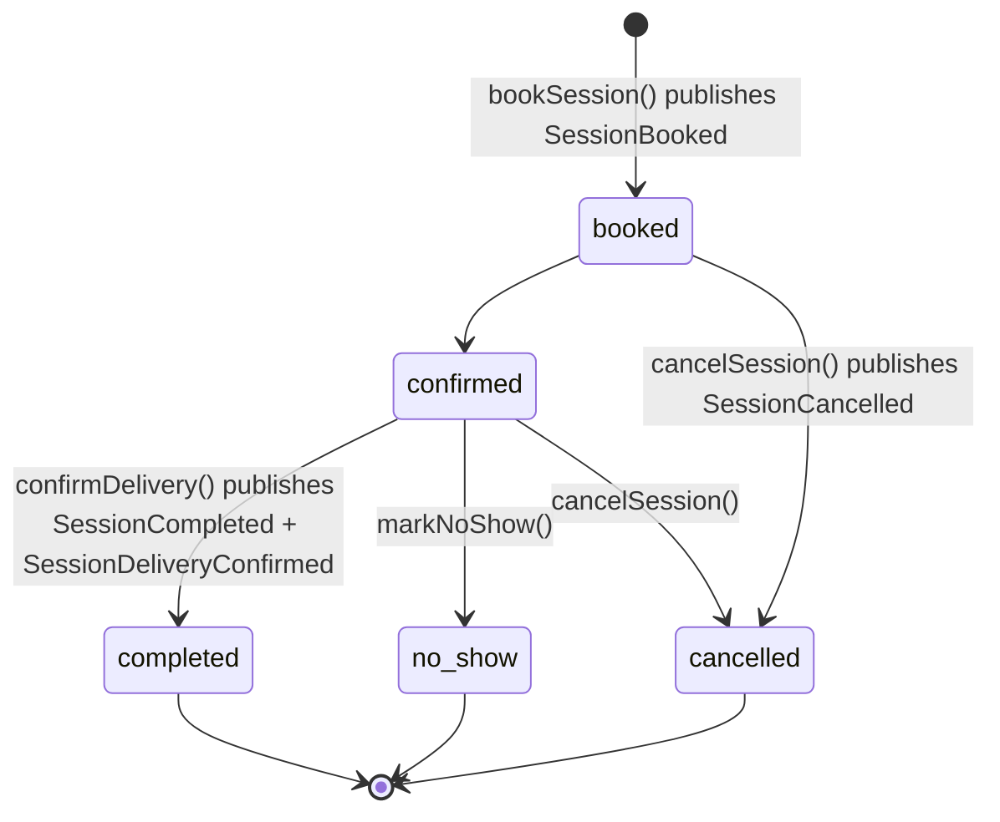
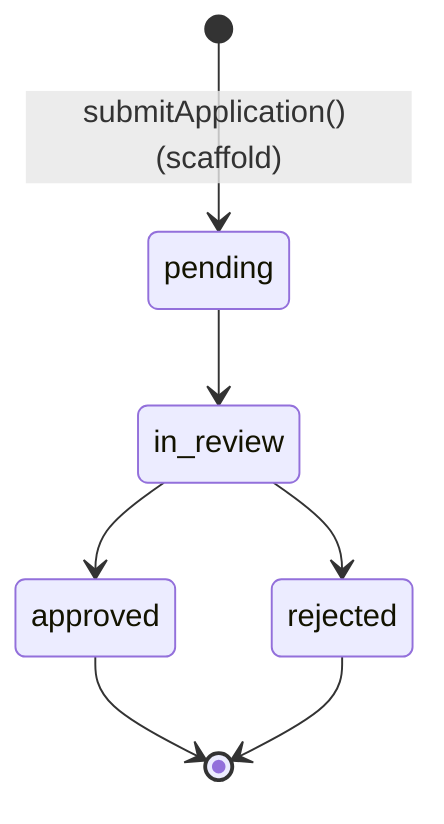
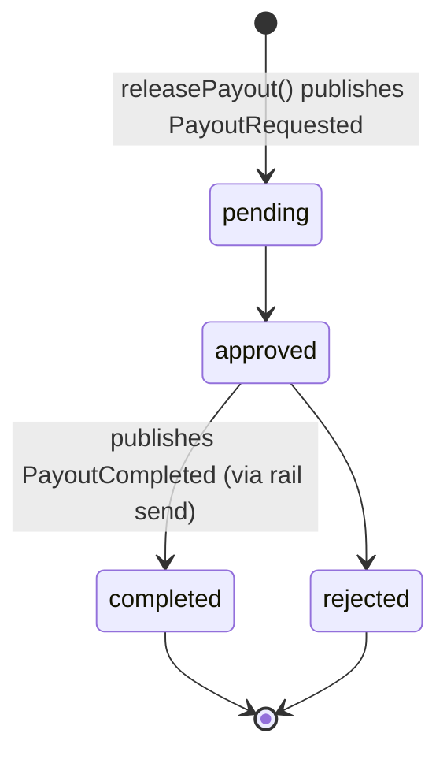
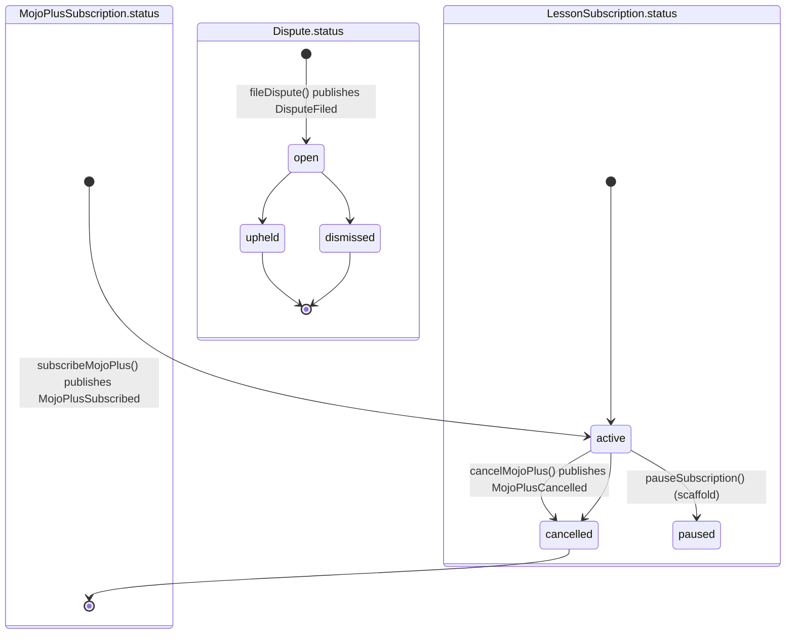
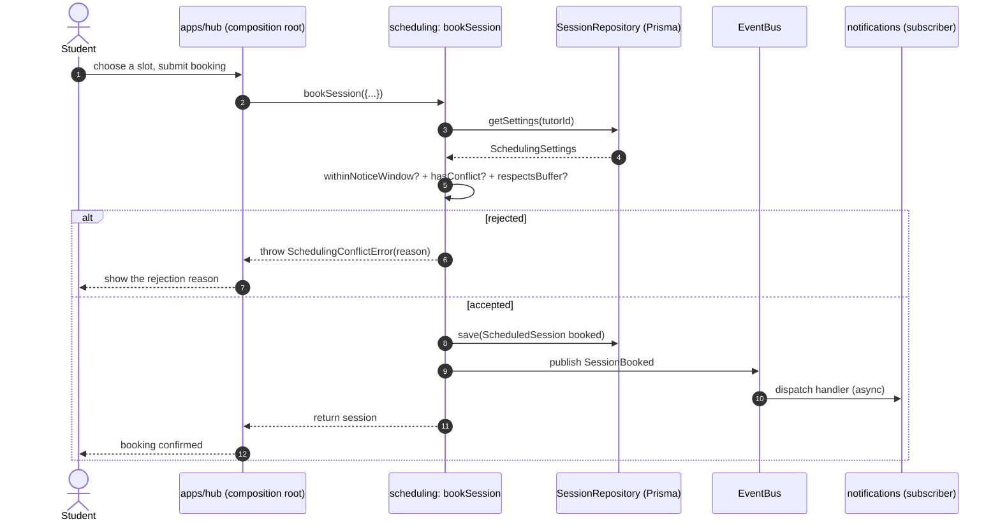
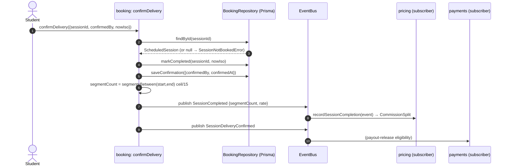
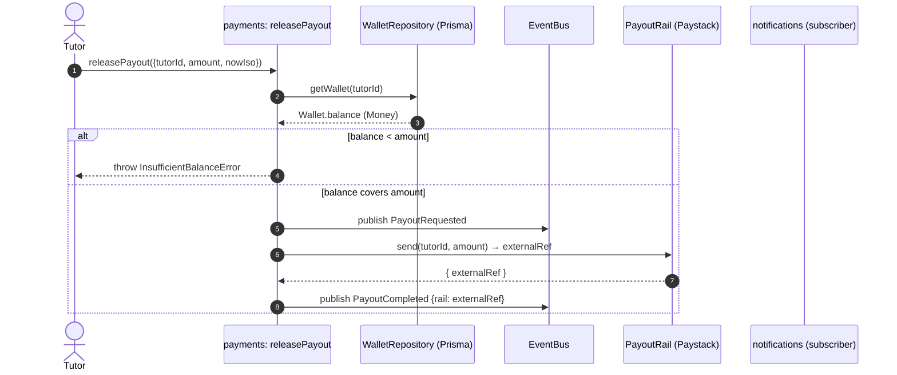
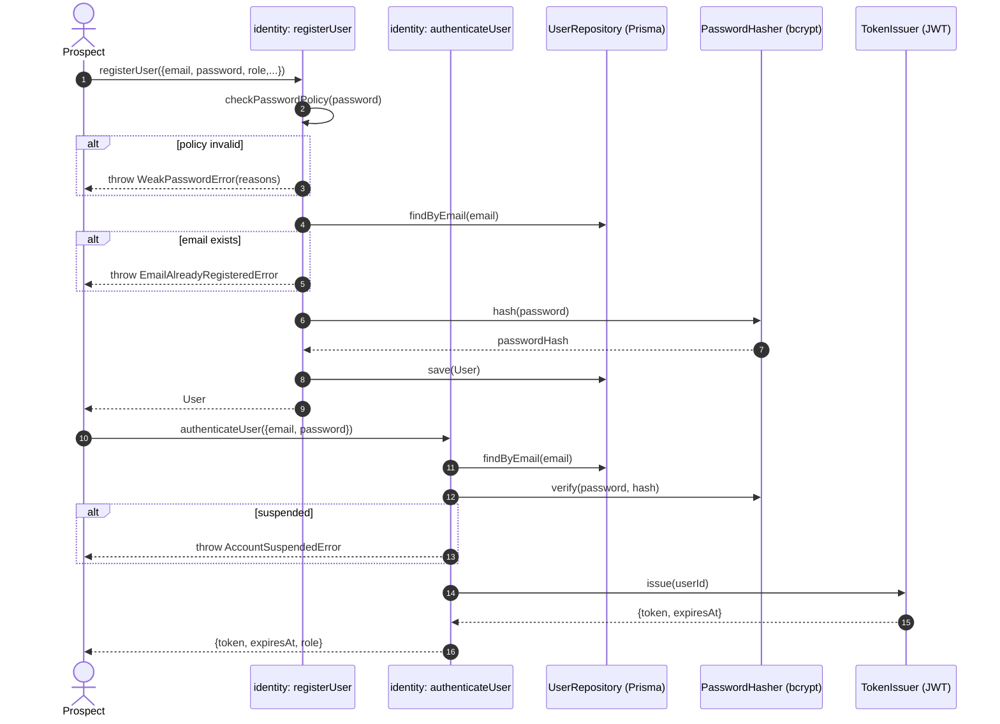
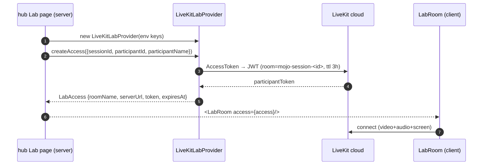
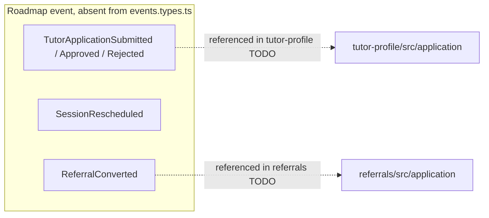

# Mojo — 04. Behavioral Diagrams

Behavior of the Mojo codebase as built: the state machines declared by the enums,
the interaction flows implemented by the use-cases and adapters, the booking
activity tree, and the concrete event catalog that exists in `libs/shared/events`.

All states below are the **actual enum values / string sets** in
`prisma/schema.prisma` and the domain types — not aspirational.

---

## 1. Session lifecycle (state diagram)

The `SessionStatus` enum: `booked → confirmed → completed | cancelled | no_show`.
Confirmed/completed transitions are driven by the booking use-cases; every status
change appends a row to `SessionStatusEvent` (the `statusHistory`).



> The `session.mark_complete`, `mark_no_show`, `reschedule` actions from the
> permissions matrix are partly represented (only `confirmDelivery`/`markNoShow` have
> booking-layer code; `markNoShow` writes `no_show` and is only stubbed in the
> repository). `reschedule` has **no** use-case yet.

---

## 2. Tutor application (state diagram)

`TutorApplication`'s `ApplicationStatus` enum. Only `submitApplication` exists in
code (writes a `pending` application); the review-queue transitions are admin-side
and not implemented.



---

## 3. Payout request (state diagram)

`PayoutRequest.status` is a string field with value set
`pending | approved | completed | rejected`. Only `makeReleasePayout` drives part of
this (publishes `PayoutRequested` then `PayoutCompleted`); the manual approval step
is admin-side and not implemented in code.



---

## 4. Other stateful entities



---

## 5. Booking a session (activity diagram)

The decision tree implemented by `makeBookSession`
(`libs/scheduling/src/application/book-session.use-case.ts`) using the pure
`conflict-detection.ts` functions:

```mermaid
flowchart TD
    A[bookSession input] --> B{tutor paused new bookings?}
    B -- yes --> X[throw SchedulingConflictError: paused]
    B -- no --> C{within minimum notice window?}
    C -- no --> Y[throw SchedulingConflictError: notice]
    C -- yes --> D[load existing booked/confirmed sessions]
    D --> E{hasConflict?}
    E -- yes --> Z[throw SchedulingConflictError: overlaps]
    E -- no --> F{respectsBuffer?}
    F -- no --> W[throw SchedulingConflictError: buffer]
    F -- yes --> G[save ScheduledSession status=booked]
    G --> H[append statusHistory {booked, now}]
    H --> I[publish SessionBooked]
    I --> J[return session]
```

---

## 6. Session booking (sequence diagram)

Shows the primary actors and the in-process event bus decoupling publisher from
subscriber modules.



---

## 7. Delivery confirmation → pricing / payments (sequence diagram)

`makeConfirmDelivery` turns a completion into financial events that `pricing` and
`payments` observe. Included infra is `PrismaBookingRepository`; the `pricing`
subscriber wiring is at the composition root (not shown as a class).



> `rate.amountMinor` is hard-coded to `session.isTrial ? 0 : 600_000` in
> `confirm-delivery.use-case.ts:44` (an Established default); the trial lesson is
> signalled by a zero rate. `pricing` reads the real per-segment rate via
> `TutorLevelReader` (`customRateMinor ?? DEFAULT_SEGMENT_RATE_NGN[level]`).

---

## 8. Payout release (sequence diagram)

`makeReleasePayout` publishes `PayoutRequested` before hitting the rail and
`PayoutCompleted` after.



---

## 9. Identity: registration & authentication (sequence diagram)

`registerUser` validates policy, checks email uniqueness, hashes via the
`PasswordHasher` port, saves; `authenticateUser` verifies, rejects suspended
accounts, and issues a token via `TokenIssuer`.



---

## 10. Lab access (sequence diagram)

`apps/hub/app/(tutor)/lab/[sessionId]/page.tsx` mints a short-lived LiveKit token
server-side per load; `LabRoom` consumes it client-side.



---

## 11. Event catalog (as defined in code)

The 12 events **that actually exist** in `libs/shared/events/src/events.types.ts`,
with the module that publishes each in the current code, and the subscribers the
planning docs assign. Wiring of subscribers happens at the composition root, so
"subscribers" below are from `assets/mojo-modules.md` unless gated in code.

| Event | Published by (in code) | Payload (from code) |
|---|---|---|
| `SessionBooked` | scheduling `bookSession` | `{ sessionId, tutorId, studentId, isTrial }` |
| `SessionCancelled` | scheduling `cancelSession` | `{ sessionId, cancelledBy, withinNoticeWindow }` |
| `SessionCompleted` | booking `confirmDelivery` | `{ sessionId, tutorId, studentId, segmentCount, rate: Money }` |
| `SessionNoShow` | *(not published in code)* | `{ sessionId, noShowBy }` |
| `SessionDeliveryConfirmed` | booking `confirmDelivery` | `{ sessionId, confirmedBy }` |
| `TutorLevelChanged` | tutor-performance `recomputeLevel` | `{ tutorId, fromLevel, toLevel }` |
| `MojoPlusSubscribed` | mojo-plus `subscribeMojoPlus` | `{ tutorId }` |
| `MojoPlusCancelled` | mojo-plus `cancelMojoPlus` | `{ tutorId }` |
| `PayoutRequested` | payments `releasePayout` | `{ tutorId, amount: Money }` |
| `PayoutCompleted` | payments `releasePayout` | `{ tutorId, amount: Money, rail }` |
| `ReviewSubmitted` | reviews `submitReview` | `{ sessionId, tutorId, rating }` |
| `DisputeFiled` | trust-safety `fileDispute` | `{ sessionId, filedBy, reason }` |
| `DisputeResolved` | *(not published in code)* | `{ disputeId, outcome }` |

### Events the planning docs list but the code catalog does NOT define



These are called out in code as TODOs (e.g. `referrals`' `track-referral.use-case.ts`
says "TODO: publish `ReferralConverted` once it's added to @mojo/shared/events"). The
catalog in the README (`@mojo/shared/events` "doesn't yet cover every event the
scaffold modules' TODO comments reference") confirms this.

> **[divergence]** The `assets/mojo-modules.md` event table lists
> `TutorApplicationSubmitted/Approved/Rejected`, `SessionRescheduled`,
> `ReferralConverted`, and `DisputeResolved` as part of the plan. Of these, only
> `DisputeResolved` is typed in `events.types.ts` (though nothing publishes it yet);
> the others are absent from the catalog entirely.
